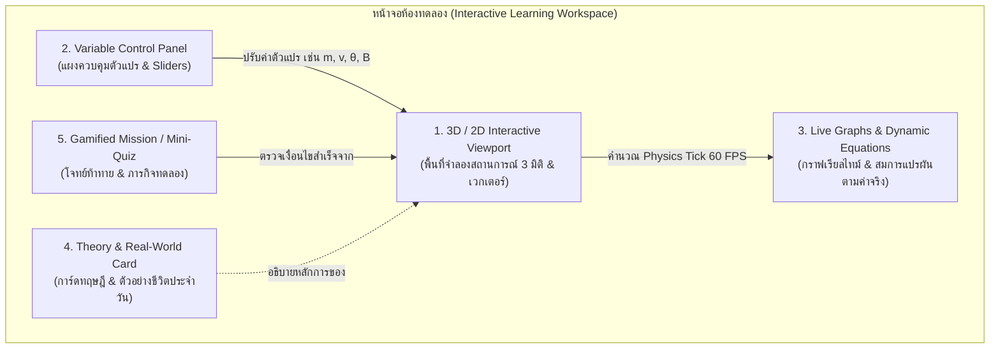
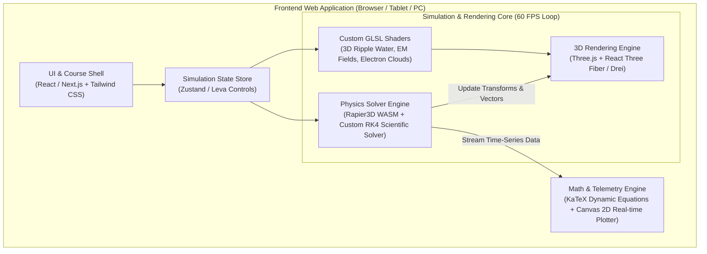

# แบบร่างโปรแกรมจำลองการเรียนรู้ฟิสิกส์เชิงโต้ตอบ (2D & 3D Interactive Physics Lab)
**เอกสารออกแบบโครงสร้างระบบ สถาปัตยกรรม และหลักสูตร (Design & Curriculum Specification)**
*อ้างอิงตามหลักสูตรแกนกลางการศึกษาขั้นพื้นฐาน (สสวท.) ระดับมัธยมศึกษาตอนปลาย (ม.4 - ม.6)*

---

## 1. ภาพรวมโครงการ (Project Overview)

**ชื่อโครงการ (ร่าง):** **PhysiVerse Lab (ฟิสิเวิร์ส แล็บ)** — ห้องปฏิบัติการฟิสิกส์เสมือนจริงแบบ 2D และ 3D
**กลุ่มเป้าหมาย:** นักเรียนระดับชั้นมัธยมศึกษาตอนปลาย (ม.4 - ม.6) และครูผู้สอนวิชาฟิสิกส์
**วัตถุประสงค์หลัก:**
1. เปลี่ยนนามธรรมในวิชาฟิสิกส์ (เช่น สนามแม่เหล็ก 3 มิติ, เฟสของคลื่น, ออร์บิทัลอะตอม, แรงลัพธ์ในระบบ 3 มิติ) ให้เป็นภาพจำลองที่มองเห็นและปรับค่าได้ทันที
2. เชื่อมโยง **ปรากฏการณ์จำลอง (3D/2D Scene)** $\leftrightarrow$ **สมการคณิตศาสตร์ไดนามิก** $\leftrightarrow$ **กราฟแบบเรียลไทม์** เข้าด้วยกันในหน้าจอเดียว
3. เปิดโอกาสให้นักเรียนเรียนรู้ผ่านการตั้งสมมติฐานและการลองผิดลองถูก (Inquiry-based & Gamified Learning) โดยไม่ต้องกังวลเรื่องข้อจำกัดของอุปกรณ์ในห้องแล็บจริง

---

## 2. โครงสร้างหน้าจอและฟีเจอร์หลักในแต่ละบทเรียน (Core Pedagogical & UI Architecture)

ทุกบทเรียนในโปรแกรมจะใช้โครงสร้าง **5-Pillar Learning Workspace** ที่統一เหมือนกันทั้งระบบ เพื่อให้นักเรียนคุ้นเคยและใช้งานได้ทันที:



### รายละเอียด 5 องค์ประกอบหลักในแต่ละบทเรียน

#### 2.1 พื้นที่จำลอง 3D & 2D เชิงโต้ตอบ (3D/2D Interactive Viewport)
* **การควบคุมมุมมอง 3 มิติ (Orbit / Pan / Zoom & Camera Presets):** นักเรียนสามารถหมุนดูระบบได้ 360 องศา หรือกดปุ่มสลับมุมมองมาตรฐาน (`Top View`, `Side View`, `Front View`, `Isometric 3D`, `First-Person Follow Cam` เกาะติดวัตถุที่กำลังเคลื่อนที่)
* **3D Gizmos & Vector Arrows:** แสดงลูกศรเวกเตอร์ 3 มิติ (เช่น แรง $\vec{F}$, ความเร็ว $\vec{v}$, ความเร่ง $\vec{a}$, สนามแม่เหล็ก $\vec{B}$, สนามไฟฟ้า $\vec{E}$) โดยขนาดและทิศทางของลูกศร 3D จะยืด-หดตามขนาดจริง และสามารถเปิด/ปิดการแตกแรงเข้าแกน $X, Y, Z$ ได้
* **Slice & Cross-Section Mode:** โหมดผ่าครึ่งโมเดล 3 มิติ เช่น ผ่าดูภายในกระบอกสูบเครื่องยนต์ความร้อน, ผ่าดูการสั่นของโมเลกุลอากาศในท่อเรโซแนนซ์, หรือผ่าดูโครงสร้างนิวเคลียสและเครื่องปฏิกรณ์

#### 2.2 แผงควบคุมตัวแปรและการเวลา (Parameter & Time Control Panel)
* **Interactive Sliders & Number Inputs:** ปรับค่าตัวแปรพร้อมหน่วยชัดเจน (เช่น มวล $m$, มุมยิง $\theta$, สัมประสิทธิ์ความเสียดทาน $\mu$, ความถี่ $f$)
* **Time Manipulation:** ปุ่ม `Play / Pause`, `Slow Motion (0.1x, 0.25x, 0.5x)` สำหรับดูจังหวะการชนหรือการแทรกสอดของคลื่น, และ `Step Forward (+1 frame / +0.01s)` เพื่อวิเคราะห์ทีละเสี้ยววินาที
* **Environment Presets:** สลับสภาพแวดล้อมได้ เช่น โลก ($g = 9.8\text{ m/s}^2$), ดวงจันทร์ ($g = 1.6\text{ m/s}^2$), ดาวอังคาร ($g = 3.7\text{ m/s}^2$), หรืออวกาศไร้แรงโน้มถ่วง พร้อมสวิตช์เปิด/ปิดแรงต้านอากาศ

#### 2.3 สมการไดนามิกและกราฟเรียลไทม์ (Dynamic Equations & Live Telemetry)
* **Dynamic Equation Scaling:** สมการฟิสิกส์ที่ขนาดตัวอักษรของตัวแปรขยายใหญ่ขึ้นหรือเปลี่ยนสีตามค่าที่นักเรียนปรับ เช่น เมื่อเพิ่มมวล $m$ ในสมการ $F = ma$ ตัวอักษร $m$ และ $F$ จะขยายใหญ่ขึ้นพร้อมแทนค่าตัวเลขจริงให้เห็นบรรทัดต่อบรรทัด
* **Synchronized Multi-Graph:** กราฟที่พล็อตค่าพร้อมกับการเคลื่อนที่ในฉาก 3D (เช่น กราฟ $s-t$, $v-t$, $a-t$ หรือกราฟพลังงานจลน์ $E_k$ เทียบกับพลังงานศักย์ $E_p$) สามารถเลื่อนเมาส์ชี้บนกราฟเพื่อย้อนดูตำแหน่งของโมเดล 3D ณ เวลานั้นได้ ( Graph Scrubbing)

#### 2.4 การ์ดทฤษฎีและการเชื่อมโยงชีวิตจริง (Concept & Real-World Connection)
* สรุปสาระสำคัญเข้าใจง่าย ไม่ยาวเกินไป พร้อมจุดสังเกต ("ลองปรับค่า X ดูสิ แล้วสังเกตว่า Y เปลี่ยนไปอย่างไร")
* **3D Real-World Showcase:** โมเดล 3 มิติของอุปกรณ์จริงที่ใช้หลักการนั้น เช่น รถไฟเหาะตีลังกา, ลำโพงเสียง, เลนส์กล้องถ่ายรูป, มอเตอร์ไฟฟ้ากระแสตรง, เครื่อง MRI

#### 2.5 โจทย์ท้าทายและมินิควิซเชิงปฏิบัติ (Interactive Missions & Mini-Quiz)
* แทนที่จะถามแต่ข้อสอบปรนัย จะมี **"ภารกิจแล็บ (Lab Mission)"** เช่น:
  * *"ปรับมุมและความเร็วต้นของปืนใหญ่ 3D เพื่อยิงข้ามกำแพงไปลงเป้าหมายที่ระยะ 45 เมตร"*
  * *"เลือกขนาดตัวต้านทาน 3D ใส่ลงในบอร์ดทดลองเพื่อให้หลอดไฟสว่างพอดีโดยไม่ขาด"*
  * *"ปรับความถี่คลื่นเสียงให้เกิดคลื่นนิ่งฮาร์มอนิกที่ 3 ในท่อปลายเปิด"*

---

## 3. โครงสร้างหลักสูตรครบ 5 หมวด (Curriculum & 3D Simulation Modules)

ครอบคลุมเนื้อหาฟิสิกส์ ม.4 - ม.6 ทั้งหมด 5 หมวดหลัก รวม 20 บทเรียนย่อย พร้อมรายละเอียดโมเดล 3 มิติในแต่ละบท:

---

### หมวดที่ 1: กลศาสตร์ (Mechanics) — ระดับชั้น ม.4

| บทที่ | หัวข้อบทเรียน | สถานการณ์จำลอง & โมเดล 3 มิติ (3D Models & Scene) | ตัวแปรที่ปรับได้ (Inputs) | กราฟและสมการหลัก (Outputs) | โจทย์ท้าทาย (Mission) |
| :--- | :--- | :--- | :--- | :--- | :--- |
| **1.1** | **การเคลื่อนที่แนวตรง** (Linear Motion) | ลู่ทดสอบรถยนต์ไฟฟ้าและจรวดความเร็วสูงในอุโมงค์ 3D พร้อมกล้องมุมมองบุคคลที่ 1 และโดรนมุมสูง | ความเร็วต้น ($u$), ความเร่ง ($a$), เวลา ($t$), แรงเบรก | กราฟ $s-t, v-t, a-t$ และ 4 สมการการเคลื่อนที่แนวตรง | เบรกให้รถหยุดหน้าเส้นชัยพอดีในระยะที่กำหนด |
| **1.2** | **กฎการเคลื่อนที่ของนิวตันและแรงเสียดทาน** (Newton's Laws) | กล่องมวลบนพื้นเอียง 3D ที่เปลี่ยนพื้นผิวได้ (น้ำแข็ง, ไม้, ยางมะตอย) และระบบรอก 3 มิติ (Atwood Machine) | มวล ($m_1, m_2$), มุมพื้นเอียง ($\theta$), สัมประสิทธิ์ความเสียดทาน ($\mu_s, \mu_k$), แรงดึง ($\vec{F}$) | แผนภาพวัตถุอิสระ 3 มิติ (3D Free-Body Diagram: $\vec{N}, m\vec{g}\sin\theta, \vec{f}$), $\sum \vec{F} = m\vec{a}$ | หามุมเอียงวิกฤตที่ทำให้กล่องเริ่มไถลลงมาพอดี |
| **1.3** | **สมดุลกลและโมเมนต์ของแรง** (Equilibrium & Torque) | เครนยกของก่อสร้าง 3D, คานดีดคานงัด และสะพานแขวน พร้อมแสดงจุดศูนย์ถ่วง (Center of Mass) 3 มิติ | ตำแหน่งวางมวลบนคาน, น้ำหนักถ่วง, มุมสลิงดึงคาน | $\sum \vec{F} = 0$, $\sum \vec{\tau} = \vec{r} \times \vec{F} = 0$, เวกเตอร์ทอร์กตามกฎมือขวา | ถ่วงดุลเครนยกตู้คอนเทนเนอร์ไม่ให้ล้มคว่ำ |
| **1.4** | **งาน พลังงาน และกฎการอนุรักษ์พลังงาน** (Work & Energy) | รางรถไฟเหาะ 3 มิติ (3D Roller Coaster) ที่นักเรียนดัดความสูงยอดเนินและลูปตีลังกาได้เอง | ความสูงจุดปล่อย ($h$), มวลรถ ($m$), ความฝืดราง, ค่าคงที่สปริงท้ายราง ($k$) | แท่งกราฟเรียลไทม์ $E_k = \frac{1}{2}mv^2$, $E_p = mgh$, $E_{es} = \frac{1}{2}kx^2$, $W_{f}$ | ออกแบบความสูงรางให้รถไฟเหาะครบลูปโดยไม่ตกรางและหยุดที่สปริงท้ายรางพอดี |
| **1.5** | **โมเมนตัมและการชน (2D & 3D Collisions)** | โต๊ะบิลเลียด 3 มิติ / ลูกตุ้มนิวตัน (Newton's Cradle) / การชนของยานอวกาศในอวกาศ 3 มิติ ($X, Y, Z$) | มวล ($m_1, m_2$), ความเร็วและมุมก่อนชน ($\vec{u}_1, \vec{u}_2$), ค่าความยืดหยุ่น ($e$: ยืดหยุ่นสมบูรณ์ ถึง ไม่ยืดหยุ่น) | เวกเตอร์โมเมนตัม $\vec{p} = m\vec{v}$ ก่อนและหลังชน, กราฟการดล $\vec{I} = \int \vec{F}dt$ | ยิงลูกบิลเลียดในมุม 3D ให้ลูกเป้าหมายลงหลุมโดยใช้หลักการอนุรักษ์โมเมนตัม |
| **1.6** | **การเคลื่อนที่แบบโปรเจกไทล์ วงกลม และ SHM** | ปืนใหญ่ 3D ยิงข้ามหุบเขา, รถแข่งเข้าโค้งเอียง (Banked Curve 3D), ดาวเทียมโคจรรอบโลก 3D, และลูกตุ้มนาฬิกา/มวลติดสปริง 3D | ความเร็วต้น ($u$), มุมยิง ($\theta$, มุมกวาด $\phi$), รัศมีโค้ง ($R$), ความยาวเชือก ($L$), ค่านิจสปริง ($k$) | เส้นวิถีพาราโบลา 3D, แรงสู่ศูนย์กลาง $F_c = \frac{mv^2}{r}$, กราฟเฟส $x(t) = A\cos(\omega t + \phi)$ | ปรับความเร็วโคจรให้ดาวเทียมเข้าสู่วงโคจรค้างฟ้าโดยไม่ตกลงโลกหรือหลุดสู่อวกาศ |

---

### หมวดที่ 2: คลื่น เสียง และแสง (Waves, Sound & Optics) — ระดับชั้น ม.5

| บทที่ | หัวข้อบทเรียน | สถานการณ์จำลอง & โมเดล 3 มิติ (3D Models & Scene) | ตัวแปรที่ปรับได้ (Inputs) | กราฟและสมการหลัก (Outputs) | โจทย์ท้าทาย (Mission) |
| :--- | :--- | :--- | :--- | :--- | :--- |
| **2.1** | **คลื่นกลและถังคลื่น 3 มิติ** (3D Ripple Tank & Mechanical Waves) | ถังคลื่นน้ำ 3 มิติ (3D Ripple Tank) ที่มีผิวน้ำกระเพื่อมจริงด้วย 3D Shader พร้อมแหล่งกำเนิดจุดคู่และช่องสลิต | ความถี่ ($f$), แอมพลิจูด ($A$), ระยะห่างแหล่งกำเนิด ($d$), ความกว้างช่องสลิต ($a$), ความลึกของน้ำ | ภาพตัดขวางคลื่น 3D, แนวบัพ (Node) และปฏิบัพ (Antinode) 3 มิติ, $v = f\lambda$, กฎของสเนลล์ | ปรับระยะห่างแหล่งกำเนิดอาพันธ์ให้เกิดแนวบัพ 4 แนวในถังคลื่น |
| **2.2** | **เสียงและการสั่นพ้อง** (Sound, Resonance & Doppler) | ท่อเรโซแนนซ์ใส 3 มิติที่เห็นอนุภาคอากาศอัด-ขยายตัวเป็น 3D Particle, และรถพยาบาลวิ่งในเมือง 3D (ปรากฏการณ์ดอปเพลอร์) | ความถี่เสียง ($f$), ความยาวท่อ ($L$), ความเร็วรถพยาบาล ($v_s$) และผู้ฟัง ($v_L$), อุณหภูมิอากาศ | กราฟคลื่นความดันและคลื่นการกระจัด, $f' = f\left(\frac{v \pm v_L}{v \mp v_s}\right)$, ระดับความเข้มเสียง $\beta$ (dB) | เลื่อนลูกสูบท่อเรโซแนนซ์หาตำแหน่งดังที่สุด 3 ลำดับแรกเพื่อคำนวณอัตราเร็วเสียง |
| **2.3** | **แสงเชิงรังสีและทัศนอุปกรณ์ 3 มิติ** (3D Ray Optics Bench) | ม้านั่งทดลองแสง 3 มิติ (3D Optical Bench) ที่มีเลนส์นูน เลนส์เว้า กระจกโค้ง ปริซึม 3 มิติ และโมเดลลูกตามนุษย์/กล้องโทรทรรศน์ | ความยาวโฟกัส ($f$), ระยะวัตถุ ($s$), ดัชนีหักเหของแก้ว ($n$), มุมยอดปริซึม | เส้นรังสีแสง 3 มิติ, ภาพจริง/ภาพเสมือน 3D, $\frac{1}{f} = \frac{1}{s} + \frac{1}{s'}$, การกระจายแสงสีรุ้งผ่านปริซึม | จัดวางเลนส์สำหรับคนสายตาสั้น/ยาว เพื่อให้โฟกัสภาพตกบนจอประสาทตา 3D พอดี |
| **2.4** | **แสงเชิงฟิสิกส์** (Physical Optics & Polarization) | ชุดทดลองสลิตคู่ของยัง (Young's Double Slit) แบบ 3 มิติ และแผ่นโพลารอยด์ 3 มิติที่หมุนซ้อนกันได้ | ความยาวคลื่นแสง ($\lambda$: 400-700 nm), ระยะห่างสลิต ($d$), มุมแผ่นโพลารอยด์ ($\theta$) | ลวดลายการแทรกสอดบนฉากโค้ง 3D, $d\sin\theta = n\lambda$, กฎของมาลุส $I = I_0\cos^2\theta$ | ใช้แสงเลเซอร์วัดความกว้างของเส้นผมผ่านแถบการเลี้ยวเบน |

---

### หมวดที่ 3: ไฟฟ้าและแม่เหล็ก (Electricity & Magnetism) — ระดับชั้น ม.5 - ม.6

| บทที่ | หัวข้อบทเรียน | สถานการณ์จำลอง & โมเดล 3 มิติ (3D Models & Scene) | ตัวแปรที่ปรับได้ (Inputs) | กราฟและสมการหลัก (Outputs) | โจทย์ท้าทาย (Mission) |
| :--- | :--- | :--- | :--- | :--- | :--- |
| **3.1** | **ไฟฟ้าสถิตและสนามไฟฟ้า 3 มิติ** (3D Electrostatics) | อวกาศ 3 มิติที่นักเรียนวางประจุบวก/ลบได้อิสระ พร้อมแสดงเส้นแรงไฟฟ้า 3 มิติ และพื้นผิวสมศักย์ (Equipotential Surfaces 3D) | ขนาดประจุ ($q_1, q_2, ...$), ตำแหน่งประจุในพิกัด $(x,y,z)$, แผ่นตัวนำคู่ขนาน | กฎของคูลอมบ์ $F = \frac{kq_1q_2}{r^2}$, เวกเตอร์สนามไฟฟ้า $\vec{E}$, ศักย์ไฟฟ้า $V$ เป็นภูเขา 3 มิติ | วางประจุบังคับทิศทางให้อิเล็กตรอนวิ่งอ้อมสิ่งกีดขวางเข้าเป้าหมาย (Electric Golf) |
| **3.2** | **วงจรไฟฟ้ากระแสตรง** (3D Breadboard & DC Circuits) | โต๊ะต่อวงจรไฟฟ้า 3 มิติ (แบตเตอรี่, ตัวต้านทานอ่านค่าแถบสี, หลอดไฟ, มัลติมิเตอร์ 3D) ที่เห็นอิเล็กตรอนไหลในสายไฟ | แรงเคลื่อนไฟฟ้า ($\mathcal{E}$), ความต้านทาน ($R_1, R_2, R_3$), การต่ออนุกรม/ขนาน | กฎของโอห์ม $V = IR$, กฎของเคอร์ชอฟฟ์ ($\sum I = 0, \sum V = 0$), กำลังไฟฟ้า $P = IV$ | ต่อวงจรแบ่งแรงดัน (Voltage Divider) เพื่อจ่ายไฟ 3.3V ให้เซ็นเซอร์จากถ่าน 9V |
| **3.3** | **แม่เหล็กและสนามแม่เหล็ก 3 มิติ** (3D Electromagnetism) | ขดลวดโซลินอยด์ 3D, ประจุวิ่งเป็นเกลียว (Helix) ในสนามแม่เหล็ก 3D, และมอเตอร์ไฟฟ้ากระแสตรง 3 มิติ พร้อมโมเดล "มือขวา 3D" | กระแสไฟฟ้า ($I$), สนามแม่เหล็ก ($\vec{B}$), ความเร็วประจุ ($\vec{v}$), มุมยิงประจุ, จำนวนรอบขดลวด ($N$) | แรงลอเรนตซ์ $\vec{F} = q(\vec{v} \times \vec{B})$, $\vec{F} = I(\vec{L} \times \vec{B})$, โมเมนต์คู่ควบขดลวด $M = BINA\cos\theta$ | ใช้เครื่องแมสสเปกโตรมิเตอร์ 3D คัดแยกไอออนที่มีมวลต่างกันด้วยสนามแม่เหล็ก |
| **3.4** | **การเหนี่ยวนำแม่เหล็กไฟฟ้าและไฟฟ้ากระแสสลับ** (Faraday & AC) | แท่งแม่เหล็ก 3D ที่นักเรียนลากสอดเข้า-ออกขดลวดได้เอง, ไดนาโมปั่นไฟ 3D, และวงจร RLC กระแสสลับ | ความเร็วการขยับแม่เหล็ก, ความถี่การหมุนไดนาโม ($\omega$), ค่า $R, L, C$ ในวงจร | กฎของฟาราเดย์ $\mathcal{E} = -N\frac{d\Phi_B}{dt}$, กฎของเลนซ์, แผนภาพเฟเซอร์ 3D (Phasor Diagram) และกราฟ $V(t), I(t)$ | ปรับค่าตัวเก็บประจุ $C$ ให้วงจร RLC เกิดการสั่นพ้อง (Resonance) เพื่อรับสัญญาณวิทยุ |

---

### หมวดที่ 4: สมบัติสสาร ความร้อน และของไหล (Matter, Heat & Fluids) — ระดับชั้น ม.6

| บทที่ | หัวข้อบทเรียน | สถานการณ์จำลอง & โมเดล 3 มิติ (3D Models & Scene) | ตัวแปรที่ปรับได้ (Inputs) | กราฟและสมการหลัก (Outputs) | โจทย์ท้าทาย (Mission) |
| :--- | :--- | :--- | :--- | :--- | :--- |
| **4.1** | **ความร้อน แก๊สอุดมคติ และทฤษฎีจลน์** (3D Kinetic Gas Chamber) | กระบอกสูบใส 3 มิติที่มีลูกบอลอะตอมแก๊สหลายร้อยลูกวิ่งชนผนัง 3D พร้อมลูกสูบที่กดอัดหรือขยายตัวได้ | ความดัน ($P$), ปริมาตร ($V$), อุณหภูมิ ($T$), จำนวนโมล ($n$), ชนิดแก๊ส (He, Ne, Ar) | $PV = nRT$, $E_k = \frac{3}{2}k_BT$, กราฟการกระจายความเร็วแมกซ์เวลล์-โบลตซ์มันน์ และกราฟ $P-V$ | ควบคุมวัฏจักรเครื่องยนต์ความร้อน (Carnot / Otto Cycle) บนกราฟ $P-V$ ให้ได้งานสุทธิสูงสุด |
| **4.2** | **ของแข็งและสภาพยืดหยุ่น** (Elasticity & Young's Modulus) | เครื่องดึงทดสอบวัสดุ 3 มิติ (Tensile Testing Machine) ที่ดึงเส้นลวดเหล็ก ทองแดง ยาง จนยืดและขาด | แรงดึง ($F$), พื้นที่หน้าตัด ($A$), ความยาวเริ่มต้น ($L_0$), ชนิดวัสดุ | กราฟความเค้น-ความเครียด ($\sigma - \varepsilon$), ค่ามอดูลัสของยัง $Y = \frac{FL_0}{A\Delta L}$, ขีดจำกัดการแปรผันตรง | เลือกขนาดสายเคเบิลลิฟต์ 3D ให้รับน้ำหนักผู้โดยสารได้โดยไม่เกินขีดจำกัดสภาพยืดหยุ่น |
| **4.3** | **สถิตยศาสตร์และพลศาสตร์ของไหล** (3D Fluid Dynamics) | แม่แรงไฮดรอลิก 3D, เรือดำน้ำปรับถังอับเฉา 3D, และอุโมงค์ลม/ท่อเวนจูรี 3 มิติที่แสดงเส้นกระแสไหล (3D Streamlines) | ความหนาแน่นของเหลว ($\rho$), พื้นที่หน้าตัดท่อ ($A_1, A_2$), ความเร็วของไหล ($v$), มุมปะทะปีกเครื่องบิน | กฎของพาสคัล, แรงลอยตัวอาร์คิมิดีส $F_B = \rho Vg$, สมการความต่อเนื่อง $A_1v_1 = A_2v_2$, สมการแบร์นูลลี | ปรับมุมปะทะและความเร็วลมในปีกเครื่องบิน 3D ให้เกิดแรงยก (Lift) ชนะน้ำหนักเครื่องบิน |

---

### หมวดที่ 5: ฟิสิกส์แผนใหม่ (Modern Physics) — ระดับชั้น ม.6

| บทที่ | หัวข้อบทเรียน | สถานการณ์จำลอง & โมเดล 3 มิติ (3D Models & Scene) | ตัวแปรที่ปรับได้ (Inputs) | กราฟและสมการหลัก (Outputs) | โจทย์ท้าทาย (Mission) |
| :--- | :--- | :--- | :--- | :--- | :--- |
| **5.1** | **คลื่นแม่เหล็กไฟฟ้า** (3D EM Wave Propagation) | คลื่นสนามไฟฟ้า $\vec{E}$ และสนามแม่เหล็ก $\vec{B}$ ที่ตั้งฉากกันและเคลื่อนที่ไปในอวกาศ 3 มิติ พร้อมเสาอากาศส่งสัญญาณ | ความถี่คลื่น ($f$ ตั้งแต่วิทยุ ไมโครเวฟ แสง ไปจนถึงรังสีแกมมา), แอมพลิจูด | เวกเตอร์ $\vec{E} \perp \vec{B} \perp \vec{c}$, $c = f\lambda$, สเปกตรัมคลื่นแม่เหล็กไฟฟ้า | เลือกย่านความถี่คลื่นแม่เหล็กไฟฟ้าให้เหมาะกับภารกิจ (เรดาร์, รีโมท, เอกซเรย์กระดูก) |
| **5.2** | **ฟิสิกส์อะตอมและปรากฏการณ์โฟโตอิเล็กทริก** (Atomic & Quantum 3D) | โมเดลอะตอม 3 มิติ (ทอมสัน, รัทเทอร์ฟอร์ดยิงอนุภาคแอลฟาชนแผ่นทองคำ, บอร์ และกลุ่มหมอกอิเล็กตรอน 3D) + หลอดโฟโตอิเล็กทริก 3D | ความยาวคลื่นแสงที่ฉาย ($\lambda$), ความเข้มแสง, ชนิดโลหะแคโทด (ค่าฟังก์ชันงาน $W_0$), ศักย์หยุดยั้ง ($V_s$) | $E_k = hf - W_0$, ระดับชั้นพลังงานอะตอมไฮโดรเจน $E_n = \frac{-13.6}{n^2}\text{ eV}$ และเส้นสเปกตรัมอนุกรมบาลเมอร์ | หาค่าความถี่ขีดเริ่ม ($f_0$) และคำนวณค่านิจของพลังค์ ($h$) จากกราฟ $E_k - f$ |
| **5.3** | **ฟิสิกส์นิวเคลียร์และกัมมันตภาพรังสี** (3D Nuclear Physics) | นิวเคลียส 3 มิติที่สลายตัวให้รังสี $\alpha, \beta, \gamma$ วิ่งผ่านสนามแม่เหล็กและแผ่นกั้น (กระดาษ, อะลูมิเนียม, ตะกั่ว) และปฏิกิริยาลูกโซ่ฟิชชัน 3D | ครึ่งชีวิต ($T_{1/2}$), จำนวนนิวเคลียสตั้งต้น ($N_0$), ความลึกในการสอดแท่งควบคุมโบรอนในเตาปฏิกรณ์ 3D | กราฟการสลายตัว $N(t) = N_0 e^{-\lambda t}$, สมการพลังงานยึดเหนี่ยว $\Delta E = \Delta m c^2$ | ควบคุมแท่งดูดกลืนนิวตรอนในเตาปฏิกรณ์ฟิชชัน 3D ให้ผลิตไฟฟ้าคงที่โดยไม่เกิดความร้อนเกิน |

---

## 4. สถาปัตยกรรมระบบและเทคโนโลยีที่แนะนำ (Technical Architecture & 3D Tech Stack)

เพื่อให้โปรแกรมสามารถเปิดใช้งานได้ทั้งบนคอมพิวเตอร์ในห้องเรียน แท็บเล็ต และสมาร์ทโฟนของนักเรียนโดยไม่ต้องติดตั้งโปรแกรมซับซ้อน แนะนำสถาปัตยกรรม **Web-based 3D Simulation Platform**:



### 4.1 รายละเอียดชุดเทคโนโลยี (Tech Stack Specification)
1. **3D Graphics & Rendering (`Three.js` + `React Three Fiber` / `@react-three/drei`):**
   * ใช้เรนเดอร์ฉาก 3 มิติ, แสงเงา, กล้อง `OrbitControls`, ลูกศรเวกเตอร์ 3 มิติ (`ArrowHelper` / Custom 3D Gizmos), และป้ายกำกับสมการที่ลอยติดกับวัตถุในโลก 3 มิติ (`<Html>` overlay)
   * รองรับการโหลดโมเดลอุปกรณ์วิทยาศาสตร์ 3 มิติในรูปแบบ `.glb` / `.gltf` (บีบอัดด้วย Draco เพื่อให้โหลดเร็ว)
2. **Scientific Physics Solver (Hybrid Physics Engine):**
   * **Analytical & Runge-Kutta (RK4) Solver:** สำหรับการทดลองที่ต้องการความแม่นยำทางคณิตศาสตร์ 100% ตามสูตรในหนังสือเรียน สสวท. (เช่น โปรเจกไทล์, SHM, วงโคจรดาวเคราะห์, ลอเรนตซ์ฟอร์ซ, วงจร RLC) เพื่อให้นักเรียนคำนวณด้วยมือแล้วได้คำตอบตรงกับในโปรแกรมทุกทศนิยม
   * **Rigid-Body 3D Engine (`Rapier3D` WebAssembly):** สำหรับการทดลองที่มีการชนซับซ้อนหลายวัตถุ หรือการโต้ตอบอิสระในฉาก 3 มิติ
3. **Custom GLSL Shaders:**
   * สำหรับจำลองปรากฏการณ์ต่อเนื่อง เช่น ผิวน้ำกระเพื่อมในถังคลื่น 3 มิติ (3D Ripple Tank), สนามศักย์ไฟฟ้า 3 มิติ, และหมอกอิเล็กตรอน (Quantum Orbitals)
4. **Dynamic Equations & Real-Time Graphing:**
   * **KaTeX:** เรนเดอร์สมการฟิสิกส์ความเร็วสูงที่อัปเดตตัวเลขและขนาดตัวแปรได้ 60 ครั้งต่อวินาทีโดยไม่กระตุก
   * **HTML5 Canvas High-Frequency Plotter:** วาดกราฟเรียลไทม์ ($s-t, v-t, a-t, P-V, V-I$) ควบคู่ไปกับฉาก 3D

---

## 5. โครงสร้างข้อมูลของแต่ละบทเรียน (Module Data Schema)

เพื่อให้สามารถเพิ่มบทเรียนใหม่ๆ ได้ง่ายในอนาคต ทุกบทเรียนจะถูกนิยามด้วยโครงสร้าง JSON/TypeScript มาตรฐานเดียวกัน:

```typescript
export interface PhysicsLessonModule {
  id: string;                    // เช่น "mech-06-projectile-3d"
  code: string;                  // รหัสตรงตามหลักสูตร เช่น "ว31201-06"
  title: string;                 // ชื่อบทเรียนภาษาไทย
  gradeLevel: "ม.4" | "ม.5" | "ม.6";
  category: "mechanics" | "waves" | "electromagnetism" | "thermodynamics" | "modern_physics";
  
  // การตั้งค่าฉาก 3 มิติ
  scene3DConfig: {
    defaultCameraPosition: [number, number, number];
    cameraPresets: Array<{ name: string; position: [number, number, number]; target: [number, number, number] }>;
    availableVectors: Array<{ id: string; label: string; symbol: string; color: string; defaultVisible: boolean }>;
    environmentOptions: Array<{ name: string; gravity: number; airResistance: number }>;
  };

  // ตัวแปรที่นักเรียนปรับค่าได้ (Sliders)
  parameters: Array<{
    key: string;                 // เช่น "initialVelocity"
    symbol: string;              // เช่น "u"
    label: string;               // เช่น "ความเร็วต้น"
    unit: string;                // เช่น "m/s"
    min: number;
    max: number;
    step: number;
    defaultValue: number;
  }>;

  // สมการไดนามิกและกราฟ
  equations: Array<{
    latexTemplate: string;       // เช่น "s_x = u \\cos(\\theta) \\cdot t"
    liveCalculation: string;     // แสดงการแทนค่าตัวเลขจริง
  }>;
  graphs: Array<{
    id: string;
    title: string;
    xAxis: { label: string; unit: string; key: string };
    yAxes: Array<{ label: string; unit: string; key: string; color: string }>;
  }>;

  // โจทย์ท้าทายและมินิควิซ
  missions: Array<{
    id: string;
    title: string;
    description: string;
    targetCondition: string;     // เงื่อนไขผ่านภารกิจ เช่น "abs(landingX - 45.0) < 0.5"
    hint: string;
  }>;
}
```

---

## 6. แผนการพัฒนาและส่งมอบงาน (Development Roadmap)

การพัฒนาแบ่งออกเป็น 4 ระยะ (Phases) เพื่อให้สามารถนำไปทดสอบกับนักเรียนได้เร็วที่สุด:

### ระยะที่ 1: Core 3D Engine & หมวดกลศาสตร์ (Mechanics Foundation)
* สร้างโครงสร้างหน้าจอ **5-Pillar Learning Workspace** (3D Viewport, Variable Controls, Live Graphs, Dynamic Equations, Mission System)
* พัฒนาระบบแสดงลูกศรเวกเตอร์ 3 มิติ ($\vec{F}, \vec{v}, \vec{a}$) และระบบควบคุมเวลา (Play/Pause/Slow-mo)
* เปิดใช้งาน 6 บทเรียนแรกใน **หมวดกลศาสตร์ (ม.4)** (การเคลื่อนที่แนวตรง, กฎนิวตันบนพื้นเอียง 3D, สมดุลโมเมนต์, รถไฟเหาะอนุรักษ์พลังงาน 3D, การชน 3D, โปรเจกไทล์ & SHM)

### ระยะที่ 2: หมวดคลื่น เสียง แสง และ 3D Shaders (Waves & Optics)
* พัฒนา 3D Ripple Tank Shader สำหรับการแทรกสอดและเลี้ยวเบนของคลื่นน้ำ 3 มิติ
* พัฒนา 3D Optical Bench สำหรับการลากวางเลนส์ กระจก และปริซึมพร้อมระบบ Ray Tracing 3 มิติ
* เปิดใช้งาน 4 บทเรียนใน **หมวดคลื่น เสียง และแสง (ม.5)**

### ระยะที่ 3: หมวดไฟฟ้า แม่เหล็ก และของไหล (Electromagnetism & Fluids)
* พัฒนาระบบแสดงเส้นสนามไฟฟ้าและสนามแม่เหล็ก 3 มิติ (3D Field Lines & Right-Hand Rule Visualizer)
* พัฒนาโต๊ะต่อวงจรไฟฟ้า 3 มิติ และกระบอกสูบแก๊สอุดมคติ 3 มิติ (3D Particle Gas Chamber)
* เปิดใช้งาน 7 บทเรียนใน **หมวดไฟฟ้า-แม่เหล็ก และความร้อน-ของไหล (ม.5 - ม.6)**

### ระยะที่ 4: หมวดฟิสิกส์แผนใหม่ และระบบห้องเรียนสำหรับครู (Modern Physics & Classroom Mode)
* พัฒนาโมเดลอะตอม 3 มิติ, ปรากฏการณ์โฟโตอิเล็กทริก และเตาปฏิกรณ์นิวเคลียร์ 3 มิติ
* เพิ่มโหมดสำหรับครูผู้สอน (Teacher Dashboard): สร้างลิงก์โจทย์ภารกิจ (Custom Mission Link) ส่งให้นักเรียนทำและดูสถิติความเข้าใจของนักเรียนทั้งห้อง
